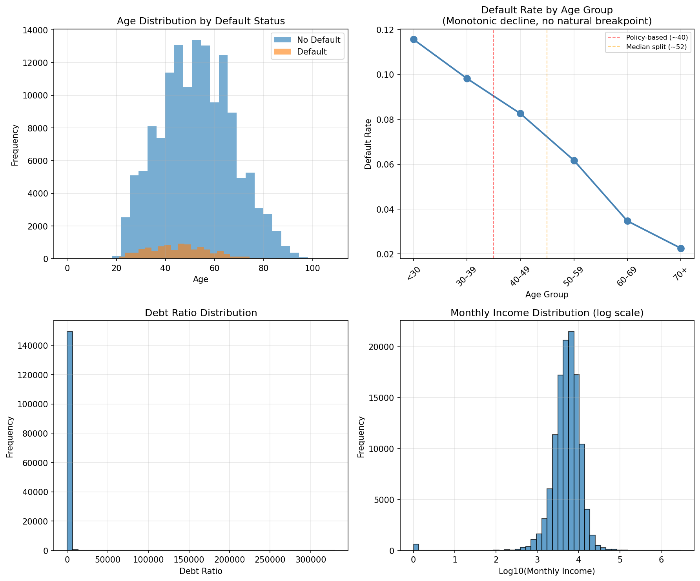
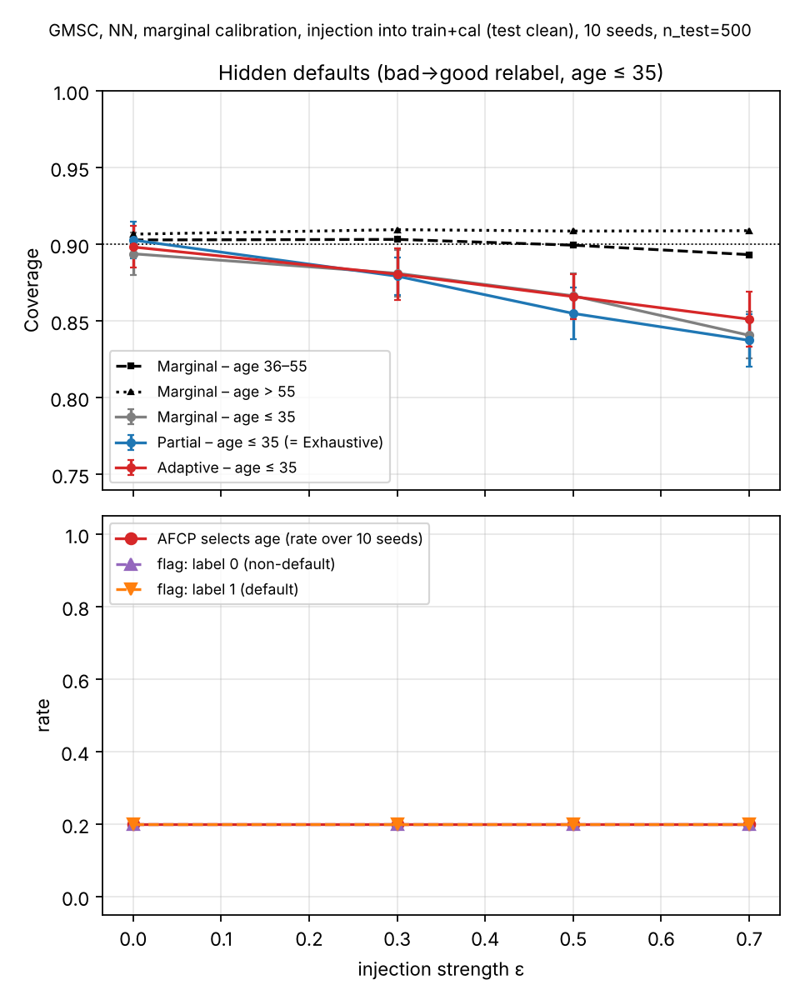

# Give Me Some Credit (GMSC) Dataset Documentation

This document provides comprehensive documentation of the Give Me Some Credit dataset,
including exploratory data analysis and the design of AFCP fairness experiments.

## 1. Exploratory Data Analysis

### 1.1 Dataset Overview

The Give Me Some Credit dataset comprises 150,000 credit records with 11 features
(after removing the index column). The target variable is binary credit default
(`SeriousDlqin2yrs`), with 93.3% non-default (0) and 6.7% default (1) observations.

**Key statistics:**
- Total observations: 150,000
- Target variable: `SeriousDlqin2yrs` (binary, 0 = no default, 1 = default)
- Target distribution: 0 (93.3%), 1 (6.7%)
- Missing values: 33,655 total
  - MonthlyIncome: 29,731 missing (19.8%)
  - NumberOfDependents: 3,924 missing (2.6%)
- Data entry issues: 1 observation with age ≤ 0 (likely data error)

### 1.2 Column Index Reference

| Column | Type | Description |
|--------|------|-------------|
| SeriousDlqin2yrs | int | Target: serious delinquency in past 2 years (0/1) |
| RevolvingUtilizationOfUnsecuredLines | float | % of unsecured credit lines used |
| age | int | Age of borrower |
| NumberOfTime30-59DaysPastDueNotWorse | int | Times 30-59 days past due |
| DebtRatio | float | Monthly debt payments / monthly income |
| MonthlyIncome | float | Gross monthly income |
| NumberOfOpenCreditLinesAndLoans | int | Open credit lines and loans |
| NumberOfTimes90DaysLate | int | Times 90+ days past due |
| NumberRealEstateLoansOrLines | int | Real estate loans and lines |
| NumberOfTime60-89DaysPastDueNotWorse | int | Times 60-89 days past due |
| NumberOfDependents | float | Number of dependent children |

### 1.3 Sensitive Attribute Candidates

**Age.** The only demographic attribute available in the dataset. Age is widely used in
fairness benchmarks for credit scoring. Age exhibits substantial variation across the
population and is associated with the observed default rate.

**MonthlyIncome.** May be interpreted as a socioeconomic status proxy, a socially
relevant characteristic. However, MonthlyIncome contains nearly 20% missing values
and functions primarily as a core predictive feature rather than a demographic protected
attribute. Socioeconomic status is not itself a protected attribute in fairness
benchmarks for credit scoring.

**NumberOfDependents.** May be viewed as a household composition proxy. However, this
variable contains 2.6% missing values and is similarly a task-related predictor rather
than a demographic protected characteristic.

**Gender/Race.** Not available in the dataset.

### 1.4 Sensitive Attribute Decision

Based on the exploratory analysis, **age was selected as the sensitive attribute for all
AFCP experiments**. The observed default rate decreases monotonically with age, and no
natural breakpoint emerges. Therefore, two age-based thresholds are evaluated:

- **Median split (≤52 vs >52):** Primary analysis. Produces balanced subgroup sizes
  (51.6% / 48.4%), enabling robust fairness estimation.
- **Policy-based split (<40 vs ≥40):** Robustness analysis. Informed by age-discrimination
  law and produces a larger observed difference in default rates, serving as a stress test
  under imbalanced conditions.

**MonthlyIncome and NumberOfDependents were not selected** because they are predictive
socioeconomic variables rather than demographic protected attributes and both contain
substantial missing values.

### 1.5 Age Group Analysis

The EDA examines observed default rates across age cohorts to justify sensitive attribute
thresholds. Rather than imposing predetermined breakpoints, we observed default rates
across 10-year age groups to identify natural patterns.

**Observed default rate by 10-year age groups:**

| Age Group | n | Default Rate |
|-----------|---|--------------|
| <30 | 10,758 | 0.1156 |
| 30–39 | 24,339 | 0.0982 |
| 40–49 | 35,037 | 0.0826 |
| 50–59 | 34,806 | 0.0617 |
| 60–69 | 27,424 | 0.0347 |
| 70+ | 17,636 | 0.0226 |

**Pattern:** Default risk decreases monotonically with age, from 11.56% (<30) to 2.26% (70+).
No sharp breakpoint is visible. Consequently, both the median split and the policy-based
threshold are retained for the subsequent AFCP experiments.

**Important note:** These observed differences describe the empirical distribution of default
outcomes only and should not be interpreted as evidence of group-wise coverage disparities.
Coverage fairness is evaluated in the AFCP experiments (Section 2).

### 1.6 Exploratory Data Analysis Figure

**Figure description:**

- **Top-left:** Age distribution by default status. Younger borrowers are overrepresented
  among default cases (left tail of distribution).
- **Top-right:** Default rate by 10-year age cohorts showing monotonic decline from
  11.56% (<30) to 2.26% (70+). Red dashed line indicates policy-based split (~40);
  orange dashed line indicates median split (~52).
- **Bottom-left:** Debt ratio distribution, highly skewed with majority of values < 5%.
- **Bottom-right:** Monthly income distribution (log scale) approximately normal around
  log₁₀(income) ≈ 4, corresponding to ~$10,000 monthly income.

### 1.7 Final Dataset Configuration

**Preprocessing:** MonthlyIncome and NumberOfDependents contain missing values (19.8% and
2.6%, respectively). These missing values are handled in the experiment script before model
training. MonthlyIncome is imputed using the training-sample median, and NumberOfDependents
is imputed with 0. The single observation with age ≤ 0 is removed before sampling. Continuous
input features are then standardized using StandardScaler prior to neural network training.

**Age splits:** Both age definitions (median and policy-based) are computed from the age
column during data loading. No observations are removed based on age thresholds; both
splits are evaluated in fairness experiments.

---

## 2. AFCP Fairness Experiments

### 2.1 Experimental Design

This section documents the design and results of Adaptive Fairness-aware Conformal
Prediction (AFCP) experiments on GMSC, following Zhou & Sesia (2024). The experimental
design evolved after the EDA in Section 1: the manuscript's primary GMSC analysis uses a
**three-level age split** (≤35, 36–55, >55), not the median/policy-based splits originally
proposed in Section 1.4. The median, policy-based (<40), income-median, and
number-of-dependents splits were run as earlier single-attribute checks before the
three-level split was adopted as primary; they are not reported in the manuscript but are
kept in the repository (Section 2.5).

**Experimental parameters (main age-based comparison, Table 3):**
- **Model:** Simple neural network (64 hidden units, ReLU activation)
- **Train/calib/test split:** 6,000 / 6,000 / 500 (n_train_calib = 12,000)
- **Learning rate:** 0.0001
- **Nonconformity score:** Negative probability of true class, -P(y_true)
- **Nominal coverage level (α):** 0.1 (90%)
- **t-test tolerance (ttest_delta):** 0 (default AFCP)
- **Conditional coverage:** True
- **Random seeds:** 2023, 2024, 2025, 2026, 2027 (5-seed ensemble)

**Methods compared:**
1. **Marginal CP:** Standard conformal prediction, no fairness constraints
2. **Adaptive (AFCP):** With adaptive hypothesis-testing filter (default)
3. **Adaptive1:** Without adaptive hypothesis-testing filter
4. **Partial equalized coverage:** Fixed baseline method
5. **Exhaustive equalized coverage:** Fixed baseline method (identical to Partial here,
   since only one candidate sensitive attribute was supplied)

### 2.2 Primary Analysis: Three-Level Age Split (Manuscript Table 3)

**Rationale:** Age was divided into three groups — ≤35, 36–55, and >55 years — and this
configuration is reported as the manuscript's primary GMSC analysis (Section 4.2.1).
Results are averaged across five random seeds.

| Method | Overall coverage | Worst-group coverage | Coverage gap | Average set size |
|--------|-------------------|------------------------|---------------|---------------------|
| AFCP – Adaptive | 0.915 ± 0.008 | 0.893 ± 0.009 | 0.043 ± 0.012 | 1.902 ± 0.010 |
| AFCP – Adaptive1 | 0.919 ± 0.010 | 0.900 ± 0.014 | 0.036 ± 0.011 | 1.906 ± 0.011 |
| Marginal | 0.908 ± 0.012 | 0.875 ± 0.028 | 0.057 ± 0.026 | 1.892 ± 0.014 |
| Partial | 0.910 ± 0.012 | 0.886 ± 0.029 | 0.047 ± 0.037 | 1.888 ± 0.013 |
| Exhaustive | 0.910 ± 0.012 | 0.886 ± 0.029 | 0.047 ± 0.037 | 1.888 ± 0.013 |

*Worst-group coverage = minimum coverage across the three age groups, computed per seed
then averaged. Coverage gap = (max − min) coverage across the three groups, computed per
seed then averaged. These are not simply "Overall − Worst-group" because the overall
figure is the marginal coverage on the full test set, not the mean of the group figures.*

**Key finding:** Marginal CP reached satisfactory overall coverage (0.908) but its
worst-group coverage (0.875) fell well below the nominal 0.90 target. AFCP–Adaptive raised
worst-group coverage to 0.893 and narrowed the gap from 0.057 to 0.043, at the cost of a
small increase in average set size (1.892 → 1.902). Adaptive1 produced the highest overall
(0.919) and worst-group (0.900) coverage and the smallest gap (0.036), with a slightly
larger set size than Adaptive. Paired seed-level differences between AFCP–Adaptive and
Marginal CP were not statistically significant (manuscript reports p = 0.12–0.44 across
comparisons), so these are descriptive rather than confirmed systematic differences.

**Source:** `thesis_experiments/results/give_me_credit/raw/gmsc_age_3way_ndata12000_lr0.0001_ttestdelta0.0_conditionalTrue_seed{2023-2027}.txt`

### 2.3 Sensitivity to Joint Training and Calibration Sample Size (Manuscript Table 4)

**Rationale:** To explore whether AFCP's attribute-selection behavior changed as more data
became available, training and calibration samples were increased together (remaining
equal in size) while the test set was fixed at 1,000 observations. Because both samples
grow simultaneously, this analysis cannot isolate the effect of calibration-sample size
from the effects of a larger training set and re-fitted classifier. Classifiers were
trained for 200 epochs (vs. 500 in the main experiments).

AFCP–Adaptive attribute-selection rate (% of test observations for which age was selected),
by training/calibration sample size and seed (matches manuscript Table 4 exactly):

| Training sample | Calibration sample | Seed 2023 | Seed 2024 | Seed 2025 | Seed 2026 | Seed 2027 |
|------------------|----------------------|-----------|-----------|-----------|-----------|-----------|
| 2,000 | 2,000 | 0.0% | 0.0% | 0.0% | 0.0% | 0.0% |
| 4,000 | 4,000 | 99.6% | 0.0% | 0.0% | 0.0% | 100.0% |
| 6,000 | 6,000 | 100.0% | 0.0% | 0.0% | 0.0% | 100.0% |
| 8,000 | 8,000 | 100.0% | 0.0% | 0.0% | 0.0% | 100.0% |

*Seeds 2023 and 2024 have runs beyond 8,000/8,000 (up to 20,000/20,000, both flat at
100.0%/0.0% respectively) but the manuscript table stops at 8,000/8,000, the largest size
with a completed run for every one of the five seeds.*

**Data-quality note:** seed 2024 has two result files —
`sweep_summary_ntest1000_seed2024.txt` (1 row, an interrupted run) and
`sweep_summary_ntest1000_seed2024_run1.txt` (6 rows, complete). `combine_sweep_results.py`
reads the exact filename `sweep_summary_ntest1000_seed{seed}.txt` and would therefore pick
up the *incomplete* file for seed 2024, not `_run1`. The manuscript's Table 4 in fact
reports the complete run1 values (0.0% at every size). If the sweep is rerun or the combine
script is used to regenerate outputs, rename or merge the run1 file first, otherwise the
regenerated summary will silently drop seed 2024's data at sizes above 4,000/4,000.

**Key finding:** Under seeds 2023 and 2027, AFCP–Adaptive did not select age at the
smallest size (2,000/2,000) but selected it for nearly all or all test observations once
both samples reached 4,000/4,000, remaining at 100% at larger sizes. Under seeds 2024,
2025, and 2026, age was not selected at any evaluated size. Because training and
calibration sizes increase together, these transitions cannot be attributed to
calibration-sample size alone (see Section 2.6 and manuscript Section 5.4).

**Source:** `thesis_experiments/results/give_me_credit/sample_size_sweep/raw/sweep_summary_ntest1000_seed{2023-2027}.txt`, combined via `thesis_experiments/combine_sweep_results.py` into `thesis_experiments/results/give_me_credit/sample_size_sweep/summary_5seed_combined.csv`.

### 2.4 Exploratory Multi-Attribute Analysis (Manuscript Section 4.2.3)

**Rationale:** Beyond single-attribute comparisons, two multi-attribute candidate sets were
evaluated to check whether AFCP's final reported attribute selection changed when more than
one candidate demographic/socioeconomic attribute was supplied: (1) age and income, and
(2) age, income, and number of dependents. Both AFCP–Adaptive and Adaptive1 were evaluated
across five seeds, n_train_calib = 12,000, 500 test observations.

**Key finding:** In both multi-attribute configurations, the final reported selection was
empty across all test observations and all five seeds, for both Adaptive and Adaptive1.
Diagnostic logging for seeds 2023 and 2027 traced this, for the age+income configuration,
to disagreement between label-specific selections (age selected under the no-default
label, income under the default label); because the implementation reports only the
intersection of label-specific selections, the disagreement produced an empty final
output. An empty final selection therefore does not necessarily mean no attribute was
identified at any intermediate stage — see manuscript Section 5.4 for the full discussion.

**Source:** `thesis_experiments/results/give_me_credit/raw/gmsc_multi_ndata12000_lr0.0001_ttestdelta0.0_conditionalTrue_seed{2023-2027}.txt` (column `selected_none = 1.0` for the overall row confirms the empty-selection outcome).

### 2.5 Earlier Exploratory Checks: Single-Attribute Definitions (Not in Manuscript)

Before the three-level age split was adopted as primary, four single-attribute
configurations were run and combined into
`thesis_experiments/results/give_me_credit/summary_by_attribute.csv`. **These results are
not discussed or cited anywhere in the submitted manuscript** — they are kept in the
repository for transparency about the experimental process, not as evidence backing a
published claim.

| Config | Method | Overall coverage | Set size |
|--------|--------|---------------------|------------|
| age_median (≤52 vs >52) | Adaptive | 0.919 ± 0.009 | 1.906 ± 0.010 |
| age_40 (<40 vs ≥40) | Adaptive | 0.910 ± 0.011 | 1.897 ± 0.013 |
| income_median | Adaptive | 0.911 ± 0.009 | 1.898 ± 0.011 |
| dependents (0 vs ≥1) | Adaptive | 0.912 ± 0.008 | 1.900 ± 0.010 |

Full per-method, per-group figures (including Marginal/Adaptive1/Partial/Exhaustive and
Group 0/1 breakdowns) are in the CSV directly; they are not reproduced here since they do
not correspond to a manuscript claim.

### 2.6 Methodological Notes

**On the age split used:** EDA (Section 1) examined observed default rates across 10-year
age cohorts and found a monotonic decline with no sharp breakpoint, motivating the initial
median/policy-based split proposal. The experimental design subsequently moved to a
three-level split (≤35, 36–55, >55) as the primary manuscript analysis; the median,
policy-based, income, and dependents splits remain in the repository as exploratory checks
(Section 2.5) but do not appear in the manuscript.

**On ttest_delta:** All main-comparison experiments used ttest_delta = 0, the default AFCP
hypothesis test where the null hypothesis is that miscoverage does not exceed the nominal
level α (0.1). Adaptive1 omits this hypothesis-testing step, which is why Adaptive1
consistently yields larger coverage gains than Adaptive at the cost of a larger average
prediction-set size.

**On the sample-size sweep (Section 2.3):** Because training and calibration sample sizes
were increased jointly, the sweep cannot separate the effect of more calibration data from
the effect of a larger, re-fitted training set — a limitation noted explicitly in the
manuscript (Section 4.2.2) and not yet addressed by a follow-up experiment that varies
calibration size alone.

**On missing values:** MonthlyIncome and NumberOfDependents are retained as model features.
Missing values are handled during preprocessing by imputing MonthlyIncome with the
training-sample median and NumberOfDependents with 0. This preserves all observations
and leverages these variables' predictive signal while avoiding the 20% data loss that
would result from listwise deletion.

### 2.7 Conclusion

GMSC provides a high-quality testbed for AFCP fairness evaluation with clear age-related
differences in observed default rates. The manuscript's primary analysis (three-level age
split) shows that Marginal CP's satisfactory overall coverage (0.908) coexists with lower
worst-group coverage (0.875), and that AFCP–Adaptive and Adaptive1 raise worst-group
coverage and narrow the gap descriptively, though not to a statistically significant
degree across five seeds. The sample-size sweep and multi-attribute analyses further show
that AFCP's attribute-selection behavior is sensitive to calibration-sample size and to the
candidate-attribute set, which the manuscript discusses as a limitation on interpreting a
single "selected attribute" output as a complete fairness assessment (Section 5.4).

---

## 3. v2 experiments (October 2026)

Section 2 documents the Phase-1 pilot (500-epoch NN, label-conditional calibration, n_test
up to 16,000). The v2 pipeline (`thesis_experiments/v2/`, see `docs/V2_DESIGN.md`) re-runs
GMSC with an early-stopped NN or logistic regression, n_train = n_calib = 6,000,
n_test = 500, both calibration regimes, 10 seeds. Raw files: `thesis_experiments/results/v2/afcp/gmsc/`.

### 3.1 Baseline (clean data)

| model | calibration | Marginal cov / size | Partial | Exhaustive | Adaptive | AFCP selects age / none |
|---|---|---|---|---|---|---|
| NN | marginal | 0.903 / 1.03 | 0.903 / 1.04 | 0.903 / 1.04 | 0.903 / 1.04 | 0.20 / 0.80 |

(`cal_auroc` ≈ 0.84; label-conditional and LR rows in the raw files.) Coverage by age
(NN, marginal, Marginal method): ≤ 35: 0.894, 36–55: 0.903, > 55: 0.907. Sets are
near-singleton (mean size ≈ 1.03) because the default rate is 6.7 %: the marginal quantile
is met almost entirely by covering non-defaulters, so defaulters are rarely covered.

### 3.2 Hidden-defaults injection into the ≤ 35 group (NN, marginal regime, train + cal)

ε = share of the young group's default labels flipped to non-default; test clean; 10 seeds.
Summary: `thesis_experiments/results/v2/gmsc_injection_summary.csv`.

| ε | cov ≤ 35 (Marginal) | cov 36–55 / > 55 | gap | cov ≤ 35 Partial (= Exhaustive) / Adaptive | set size ≤ 35 | AFCP selects age |
|---|---|---|---|---|---|---|
| 0 | 0.894 | 0.903 / 0.907 | 0.01 | 0.903 / 0.898 | 1.06 | 0.20 |
| 0.3 | 0.881 | 0.903 / 0.910 | 0.03 | 0.879 / 0.881 | 1.03 | 0.20 |
| 0.5 | 0.866 | 0.899 / 0.909 | 0.04 | 0.855 / 0.866 | 0.99 | 0.20 |
| 0.7 | 0.841 | 0.893 / 0.909 | 0.06 | 0.837 / 0.851 | 0.95 | 0.20 |

- The **coverage disparity replicates**: the young group's coverage falls monotonically with
  ε (0.89 → 0.84, gap 0.01 → 0.06), the other two groups stay at nominal. The effect is about
  half the size of the Taiwan effect (women 0.90 → 0.80 at ε = 0.7), consistent with the
  rarer positive class and the smaller group share.
- Partial / Exhaustive (identical here: a single candidate attribute) do **not** restore the
  young group's coverage — the same calibration-contamination mechanism as on Taiwan
  (`CREDIT_TAIWAN.md` §2.2, §2.4).
- The **AFCP detection signal does not replicate**: the selection rate is 0.20 at every dose,
  and it is the same two seeds (2023, 2027) that select age at ε = 0 and at ε = 0.7. On GMSC
  the decision is seed-driven, not dose-driven. A candidate explanation, to be checked: with
  near-singleton sets the LOO miscoverage of the young calibration group is driven by its
  (few) labelled defaulters, and hidden-defaults removes exactly those, so the calibration
  evidence of under-coverage disappears while the test-set under-coverage grows.
- Mean set size for the young group drops below 1 at ε ≥ 0.5 (empty sets appear): the
  marginal quantile, calibrated on a set with fewer labelled defaults, becomes less
  conservative.
- Standard errors are larger than on Taiwan (SD of young-group coverage across seeds ≈ 0.05;
  the young group has ≈ 120 test points per seed).

### 3.3 Train-only injection: is AFCP's silence due to calibration contamination? (ε = 0.7)

Same hidden-defaults injection applied to the training set only (calibration and test clean),
10 seeds. Young-group coverage and AFCP selection:

| scope | Marginal | Partial (= Exhaustive) | Adaptive | AFCP selects age | flag label 0 / 1 |
|---|---|---|---|---|---|
| none (ε = 0) | 0.894 | 0.903 | 0.898 | 0.20 | 0.20 / 0.20 |
| train only | 0.846 | 0.892 | 0.862 | 0.10 | 0.10 / 0.11 |
| train + cal | 0.841 | 0.837 | 0.851 | 0.20 | 0.20 / 0.20 |

- With a clean calibration set, Partial / Exhaustive **do** restore the young group to ≈ 0.89
  (as on Taiwan, §2.4 there).
- The candidate explanation in 3.2 is **not supported**: AFCP still does not select age when
  the calibration labels are clean (0.10; the one selecting seed, 2027, also selects at
  ε = 0). On GMSC the LOO test does not register a 5 pp group under-coverage even when the
  calibration set is uncontaminated. Remaining candidates: near-singleton sets (LOO
  miscoverage is a 0/1 variable concentrated on the 6.7 % defaulters, so the group difference
  in calibration is small in absolute terms), and the one-sample t-test with δ = 0 and
  sig_level 0.1 being conservative for this effect size. The `ttest_delta` / `sig_level`
  sensitivity run (optional) would separate these.

Possible extensions: the label-conditional regime and logistic regression at one dose, and a `sig_level` sweep.

## References

- Credit Fusion, & Cukierski, W. (2011). Give Me Some Credit. Kaggle competition dataset.
  https://www.kaggle.com/competitions/GiveMeSomeCredit
- Zhou, Y., & Sesia, M. (2024). Conformal classification with equalized coverage for
  adaptively selected groups. *Advances in Neural Information Processing Systems (NeurIPS)*.
  arXiv:2405.15106.
- Angelopoulos, A. N., & Bates, S. (2022). A gentle introduction to conformal prediction
  and distribution-free uncertainty quantification. *arXiv preprint*.