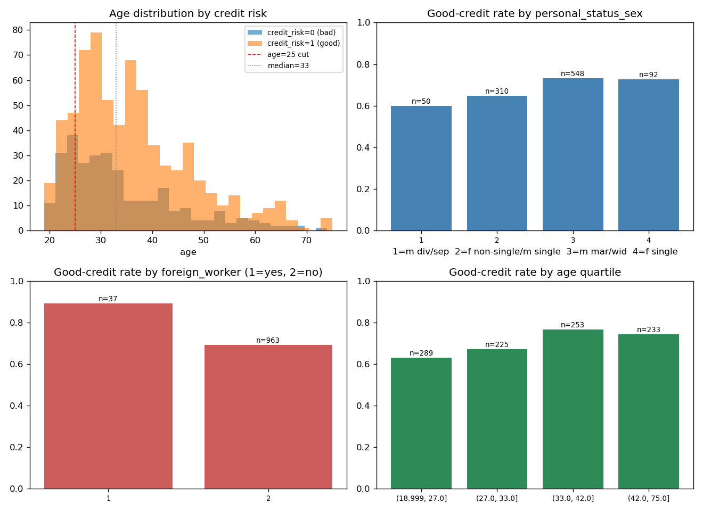

# South German Credit — Dataset Analysis & Experiments

This document records all thesis-specific decisions and results for the
South German Credit dataset. See `RESEARCH_SUMMARY.md` for the cross-dataset
overview and `SETUP_LOG.md` for the replication of the original AFCP
implementation.

**Dataset:** South German Credit (Grömping 2019), UCI ML Repository id=522.
Corrected version of the widely used Statlog German Credit dataset.
Reference: Grömping, U. (2019). *South German Credit Data: Correcting a
Widely Used Data Set.* Reports in Mathematics, Physics and Chemistry,
Report 4/2019, Beuth University of Applied Sciences Berlin.

**Source file:** `SouthGermanCredit.asc` (space-separated, German column
names; English names mapped according to Grömping's `read_SouthGermanCredit.R`
and the accompanying code table).

---

## 1. Exploratory data analysis

### 1.1 Overview

- 1,000 observations, 20 features + 1 target, no missing values.
- Target `kredit` / `credit_risk`: 0 = bad (n=300), 1 = good (n=700).
  No transformation is required; the coding is used as-is
  (`num_classes=2`, ClassNNet).
- **Sampling design (Grömping 2019):** the data are a stratified sample of
  1,000 credits (1973–1975, a large regional bank in southern Germany) in
  which bad credits are heavily oversampled: the sources report an actual
  bad-credit prevalence of about 5%, versus 30% in the sample. The 30/70
  split is therefore a design artifact, not the population distribution.
  This is directly relevant to the thesis discussion of label/selection
  bias in credit data.
- Numeric features: `duration` (median 18 months), `amount` (median 2,320,
  right-skewed, max 18,424; per Grömping 2019 the values are the result of
  an unknown monotonic transformation, not actual DM amounts), `age`
  (median 33, range 19–75).
- All remaining features are ordinal/categorical integer codes
  (2–10 levels; see code table). Per Grömping's `read_SouthGermanCredit.R`,
  these level codes are not arbitrary: they are the P2 scores from Häußler
  (1979), constructed so that larger codes indicate better creditworthiness.
  Treating them as ordinal integer inputs to the classifier is therefore a
  defensible encoding choice.
- **Coding reversal warning:** in the corrected data, the codes of
  `people_liable` (`pers`) and `foreign_worker` (`gastarb`) are the
  *opposite* of those in Open Data LMU (2010) and the original UCI German
  Credit release. Numerical comparisons with older fairness studies that
  use these variables must account for this.

### 1.2 Column index reference (0-based, `.asc` order)

| Index | Column | Index | Column |
|---|---|---|---|
| 0 | status | 11 | property |
| 1 | duration | 12 | **age** |
| 2 | credit_history | 13 | other_installment_plans |
| 3 | purpose | 14 | housing |
| 4 | amount | 15 | number_credits |
| 5 | savings | 16 | job |
| 6 | employment_duration | 17 | people_liable |
| 7 | installment_rate | 18 | telephone |
| 8 | **personal_status_sex** | 19 | **foreign_worker** |
| 9 | other_debtors | 20 | credit_risk (target) |
| 10 | present_residence | | |

These indices are hard-coded explicitly in `mc_south_german.py` to avoid
accidental index mismatches. Runtime assertions additionally verify that the
expected columns appear at the intended positions, providing a safeguard if
the column layout changes (e.g., due to encoding steps or dataset revisions).

### 1.3 Sensitive attribute candidates

**age (idx 12).**
Younger applicants have a markedly lower good-credit rate:

| Grouping | Group | n | good-credit rate |
|---|---|---|---|
| ≤25 vs >25 | ≤ 25 | 190 | 0.579 |
| | > 25 | 810 | 0.728 |
| median split | ≤ 33 | 514 | 0.648 |
| | > 33 | 486 | 0.755 |

Quartile analysis shows a broadly monotone increase in good-credit rate with
age (0.630 → 0.671 → 0.767 → 0.742).

**personal_status_sex (idx 8).**
Codes: 1 = male divorced/separated (n=50, rate 0.600),
2 = female non-single OR male single (n=310, 0.648),
3 = male married/widowed (n=548, 0.734),
4 = female single (n=92, 0.728).

Sex cannot be recovered from this variable: code 2 conflates
"female non-single" and "male single", and female widows are not listed in
any of the female categories of the corrected code table (Grömping 2019).
The variable is therefore not used as a sex attribute.

**foreign_worker (idx 19).**
1 = yes (n=37, good rate 0.892), 2 = no (n=963, 0.693). The corrected coding
resolves an implausibility of the original Statlog release, in which more
than 90% of debtors appeared to be foreign workers (Grömping 2019); in the
corrected data only 3.7% are. This makes the minority group far too small
for stable calibration-based subgroup analysis (~18 calibration observations
under a 50/50 split, fewer still under label-conditional calibration).

### 1.4 Sensitive attribute decisions

1. **Primary attribute: age (binned).** Age is the most widely used fairness
   attribute for German Credit in the literature (e.g., Kamiran & Calders
   2009, who use the ≤25 cut; Calmon et al. 2017), the group difference is
   substantial, and the variable is cleanly coded. The binning method
   is examined with both a fixed cut (≤25 vs. >25) and a median split, as a
   sensitivity analysis. Age bins are defined per dataset (no common cut with GMSC is
   possible: median age 33 here vs. 51 in GMSC).

2. **Secondary analysis: personal_status_sex (4 levels).** Included not as a
   sex attribute but as a *personal status* attribute, to examine whether
   AFCP detects coverage disparities across marital/status groups. The
   smallest group (code 1, n=50) yields ~25 calibration observations,
   which connects this analysis to the thesis's sample-size sensitivity
   findings: AFCP's t-test is not expected to reach significance for groups
   of this size.

3. **Excluded: foreign_worker.** Deliberately excluded on methodological
   grounds: the minority group (n=37) is far below any plausible threshold
   for AFCP's calibration-based t-test. Documented here for completeness.

Since AFCP selects at most one sensitive attribute during each calibration
procedure, prioritizing a single well-justified primary attribute is
consistent with both the algorithmic design and the experimental objectives
of this thesis (Zhou & Sesia 2024).

### 1.5 EDA figure

*Figure 1: Age distributions by credit risk (upper left); good-credit rates
by personal status (upper right), foreign worker status (lower left), and
age quartile (lower right). Sample sizes (n) labeled on each bar.*

### 1.6 Final dataset configuration

The experiments use the following configuration:

| Component | Choice |
|---|---|
| Features | All 20 predictor variables |
| Target | `credit_risk` (binary: 0=bad, 1=good) |
| Primary sensitive attribute | `age` (binned: ≤25 vs. >25, or median split) |
| Secondary analysis | `personal_status_sex` (4 levels, personal status) |
| Excluded | `foreign_worker` (n=37 minority group) |

---

## 2. Experiments

### 2.1 Experimental design and data setup

Three separate AFCP runs were conducted to systematically evaluate the
method's performance across different sensitive-attribute definitions on
South German Credit. All runs used identical hyperparameters
(n_train_calib=500, lr=0.0001, n_epoch=500, ttest_delta=0,
conditional=True) and were replicated across 5 random seeds (2023–2027) to
estimate stability and variance.

**Data split:** Each run allocated 500 observations: training n=250,
calibration n=250, test n=500. Target: `credit_risk` (0=bad, 1=good, binary
classification, K=2).

**Analysis organization:**

| Category | Attribute | Purpose |
|---|---|---|
| **Primary** | age ≤25 vs >25 | Main finding: AFCP on literature-based age cut |
| **Secondary robustness** | age ≤33 vs >33 | Robustness to balanced binning strategy |
| **Exploratory** | personal_status_sex (4 levels) | Behavior on very small groups (n≤20) |

### 2.2 Overall results (mean ± std across 5 seeds)

#### Primary Analysis: age ≤25 vs >25

| Method | Coverage (mean ± sd) | Prediction-set size (mean ± sd) | ΔCoverage vs Marginal | ΔLength vs Marginal | Selected Attr (%) |
|---|---|---|---|---|---|
| Adaptive | 0.9124±0.0156 | 1.765±0.062 | +0.0140 | +0.028 | 45.2 |
| Adaptive1 | 0.9184±0.0196 | 1.783±0.057 | +0.0200 | +0.046 | — |
| Marginal | 0.8984±0.0214 | 1.737±0.053 | — | — | — |
| Partial | 0.8992±0.0223 | 1.747±0.051 | +0.0008 | +0.010 | — |
| Exhaustive | 0.8992±0.0223 | 1.747±0.051 | +0.0008 | +0.010 | — |

#### Secondary Robustness Analysis: age ≤33 vs >33 (median split)

| Method | Coverage (mean ± sd) | Prediction-set size (mean ± sd) | ΔCoverage vs Marginal | ΔLength vs Marginal | Selected Attr (%) |
|---|---|---|---|---|---|
| Adaptive | 0.9144±0.0137 | 1.774±0.059 | +0.0160 | +0.038 | 60.0 |
| Adaptive1 | 0.9156±0.0140 | 1.779±0.054 | +0.0172 | +0.042 | — |
| Marginal | 0.8984±0.0214 | 1.737±0.053 | — | — | — |
| Partial | 0.8924±0.0257 | 1.718±0.067 | −0.0060 | −0.018 | — |
| Exhaustive | 0.8924±0.0257 | 1.718±0.067 | −0.0060 | −0.018 | — |

#### Exploratory Analysis: personal_status_sex (4 levels)

| Method | Coverage (mean ± sd) | Prediction-set size (mean ± sd) | ΔCoverage vs Marginal | ΔLength vs Marginal | Selected Attr (%) |
|---|---|---|---|---|---|
| Adaptive | 0.9144±0.0166 | 1.772±0.062 | +0.0160 | +0.035 | 40.0 |
| Adaptive1 | 0.9248±0.0235 | 1.800±0.066 | +0.0264 | +0.063 | — |
| Marginal | 0.8984±0.0214 | 1.737±0.053 | — | — | — |
| Partial | 0.9084±0.0282 | 1.754±0.084 | +0.0100 | +0.018 | — |
| Exhaustive | 0.9084±0.0282 | 1.754±0.084 | +0.0100 | +0.018 | — |

**Key observations:**

1. **AFCP achieves efficient coverage gains in the primary analysis (age ≤25):**
   Adaptive improves coverage by 1.4 percentage points while increasing
   prediction-set size by only 0.028. This demonstrates that meaningful
   coverage improvements can be achieved with minimal prediction-set inflation.

2. **Secondary analysis (age ≤33) reproduces the primary result:** The median
   split yields +1.6% improvement — essentially identical to the primary
   configuration — indicating robustness to the choice of age-binning strategy.

3. **Adaptive vs. Adaptive1 trade-off is explicit:** Adaptive1 (without hypothesis
   testing) yields larger coverage gains (+2.0%, +1.7%) at the cost of larger
   set-size inflation (+0.046, +0.042), illustrating the efficiency/coverage
   trade-off controlled by AFCP's hypothesis test.

4. **Partial and Exhaustive did not improve over Marginal on balanced groups:**
   On agemedian, both methods exhibited lower empirical coverage (−0.6%),
   indicating that fixed baseline methods do not reliably equalize coverage
   when groups are balanced. AFCP achieved the highest empirical coverage on
   this configuration.

5. **Attribute selection rates vary with group balance:** Higher selection rates
   in balanced settings (agemedian: 60.0% vs. age25: 45.2%) suggest that group
   balance improves statistical power for detecting coverage disparities.

6. **Exploratory analysis on personal_status_sex:** The analysis responds to
   coverage disparities in very small subgroups (n≤20), though these results
   carry high variance and should be interpreted cautiously due to limited
   calibration sample sizes.

### 2.3 Primary analysis: age ≤25 vs >25

This configuration uses the literature-based age cut (Kamiran & Calders 2009),
creating unbalanced groups (n=97 vs n=403). AFCP achieves +1.4% coverage
improvement (0.9124 vs 0.8984) while increasing prediction-set size by only
0.028. Coverage improvements are observed in both groups: younger applicants
gain +1.3%, older applicants +1.4%.

### 2.4 Secondary analysis: age ≤33 vs >33 (median split)

This configuration uses a data-driven median split, producing balanced groups
(n=263 vs n=237) with better calibration-set sizes. AFCP achieves +1.6%
coverage improvement. Notably, Partial and Exhaustive did not improve over Marginal on this
configuration, exhibiting −0.6% undercoverage. AFCP achieved the highest empirical coverage
on this configuration, suggesting that its adaptive group-detection mechanism performs
more effectively than the baseline methods in this setting.

The lower variance in Adaptive coverage (std=0.0137 vs 0.0156 for age25)
is consistent with the expectation that more balanced groups provide more stable calibration.

### 2.5 Exploratory analysis: personal_status_sex (4 levels)

This configuration examines AFCP's behavior on very small minority groups
(levels 1 and 4 have n≤20 at test time). AFCP achieves +1.6% coverage
improvement; Adaptive1 achieves +2.64%, the highest across all
configurations.

**Important caveat:** Results for personal_status_sex must be interpreted
with caution, particularly for subgroups with very small sample sizes. Level 1
(n≈19) and level 4 (n≈49) have limited calibration data (≈10 and ≈25
observations respectively), making group-level coverage estimates subject to
high variance and sensitive to specific train/test splits. The observed
improvements for these groups should be interpreted cautiously given the
limited subgroup sample sizes. The primary and secondary analyses (age-based
configurations) are more statistically stable and should be prioritized in
thesis conclusions.

### 2.6 Summary of key findings

1. **Primary finding: coverage gains with marginal set inflation (age25).** AFCP
   achieves +1.4% coverage improvement over Marginal while increasing
   prediction-set size by only 0.028. This represents the primary
   finding of the South German Credit experiments, demonstrating that AFCP provides
   fairness gains without prohibitive costs to prediction-set width.

2. **Robustness: median split reproduces primary findings (agemedian).** The
   secondary analysis using a balanced median split (age ≤33 vs >33) yields
   +1.6% coverage improvement — essentially identical to the primary result.
   This finding suggests that the observed improvements are not driven by the
   specific age-binning strategy, supporting the robustness of the core mechanism.
   The improved stability (std=0.0137 vs 0.0156) with balanced groups provides
   additional evidence that the primary result generalizes across binning choices.

3. **Trade-off between efficiency and coverage (Adaptive vs Adaptive1).** Adaptive1
   (without the adaptive hypothesis-testing filter) yields larger coverage gains (+2.0% vs +1.4% for
   Adaptive) at the cost of larger set-size inflation (+0.046 vs +0.028). This
   explicit trade-off demonstrates the role of AFCP's hypothesis-test mechanism
   in controlling efficiency/coverage balance.

4. **Baseline comparison: Partial and Exhaustive underperform on balanced groups.**
   On the median split, Partial and Exhaustive showed lower empirical coverage
   than AFCP (−0.6%), indicating that fixed baseline methods do not reliably
   equalize coverage when groups are balanced. This comparison highlights the
   practical advantage of adaptive group detection over baseline approaches.

5. **Attribute selection rates vary with group balance.** Selection rates of 45.2%
   (age25, unbalanced groups), 60.0% (agemedian, balanced groups), and 40.0%
   (pstatus, with several small subgroups) are highest for the balanced age split, suggesting
   that more balanced groups may provide greater statistical power for detecting
   coverage disparities.

6. **Exploratory: small-group behavior (personal_status_sex).** The analysis on
   personal_status_sex indicates that AFCP may respond to coverage disparities
   in very small subgroups (n≤20), although these results should be interpreted
   cautiously given the limited calibration sample sizes (n≈10 for the smallest
   subgroups). This exploratory finding extends understanding of AFCP's
   applicability to small-group settings but does not form part of the primary
   experimental evidence.

### 2.7 Methodological notes

**On ttest_delta:** All experiments used `ttest_delta = 0`, corresponding to the
default AFCP hypothesis test where the null hypothesis is that miscoverage does
not exceed the nominal level α (0.1). Adaptive1 omits this hypothesis-testing
step. This distinction explains why Adaptive1 yields larger coverage gains at
the cost of larger prediction-set inflation.

**On Partial and Exhaustive equivalence:** In all three configurations,
Partial and Exhaustive yield identical coverage and set-size results. This is
not a coincidence but a consequence of the single-attribute setting: Partial
selects the best single attribute, while Exhaustive selects all attribute
subsets; with only one sensitive attribute (idx_list=[attr]), both reduce to
the same conformal procedure. In multi-attribute settings (e.g., future work
combining age and personal_status_sex), Partial and Exhaustive would diverge.

**On seed stability (mean ± std):** Replication across 5 seeds (std ≈
0.014–0.024 for coverage) provides confidence in reported improvements and
demonstrates stability across random train/test splits and model
initializations. This is substantially more robust than single-seed reporting.

### 2.8 Conclusion

Overall, the South German Credit experiments demonstrate that AFCP improves
empirical coverage in the primary age-based analysis (age ≤25), and this finding
is robustly reproduced under an alternative age-binning strategy (age ≤33 median split)
while requiring only a small increase in prediction-set size. The observed
improvements remain stable across five independent random seeds and are robust to
the two age-binning strategies considered here.

The strongest and most reliable results are obtained for the age-based analyses,
which rely on sufficiently large subgroup sizes (n≥97 per group). The exploratory
analysis using `personal_status_sex` indicates that AFCP can also respond to
coverage disparities in smaller groups (n≤50), although these estimates
should be interpreted cautiously given the limited calibration sample sizes (n≈10
for the smallest subgroups). This pattern is consistent with the thesis's broader
finding that AFCP's adaptive mechanisms are sensitive to both calibration sample
size and group-balance; primary analyses take precedence over exploratory results.

## 3. v2 baseline (October 2026)

Section 2 documents the Phase-1 pilot (5 seeds, 500-epoch NN, label-conditional calibration).
The v2 pipeline re-runs the primary configuration with the early-stopped NN and logistic
regression, n_train = n_calib = 350, n_test = 300 (all 1,000 rows used), both calibration
regimes, 10 seeds (2023–2032). Raw files: `thesis_experiments/results/v2/afcp/sgc/`; summary:
`thesis_experiments/results/v2/sgc_baseline_summary.csv`. No injection on SGC: the
(group × label) calibration cells are too small (≈ 20–50 points).

Coverage by age (Marginal method; age ≤ 25 / > 25), AFCP selection rate for age:

| model | regime | overall cov / size | ≤ 25 | > 25 | AFCP selects age / none |
|---|---|---|---|---|---|
| NN | marginal | 0.896 / 1.62 | 0.888 | 0.898 | 0.30 / 0.70 |
| NN | label-conditional | 0.902 / 1.69 | 0.893 | 0.905 | 0.30 / 0.70 |
| LR | marginal | 0.896 / 1.45 | 0.892 | 0.897 | 0.30 / 0.70 |
| LR | label-conditional | 0.901 / 1.62 | 0.908 | 0.900 | 0.30 / 0.70 |

(`cal_auroc` 0.74 NN, 0.77 LR; across-seed SD of the ≤ 25 group's coverage ≈ 0.05 — the
group has ≈ 55 test points per seed.)

- No age disparity beyond noise in either regime; median split (≤ 33 / > 33) gives the same
  picture (≤ 33: 0.88–0.89, > 33: 0.90–0.92).
- Set sizes are large (1.45–1.69 of a maximum 2) because the classifier is weak on 350
  training rows: SGC illustrates the small-n regime in which conformal sets carry little
  information regardless of the fairness method.
- AFCP selects age in 3 of 10 seeds in every configuration — the same seed-level, non-dose
  behaviour as on GMSC (`CREDIT_GMSC.md` §3.2).
