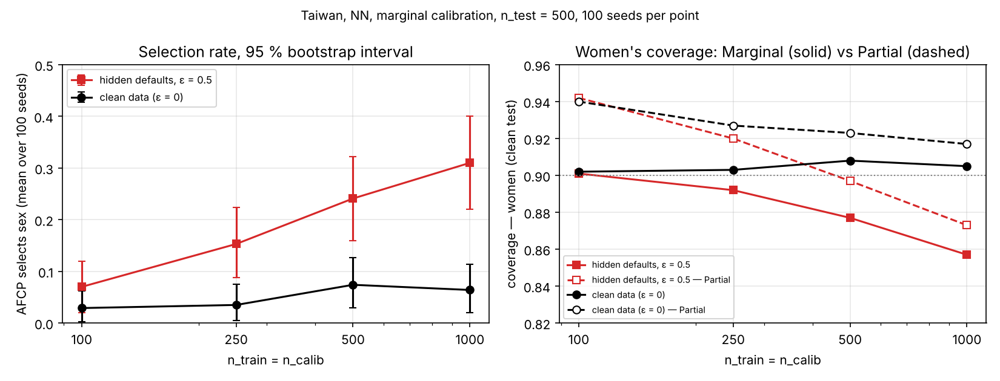

# Default of Credit Card Clients (Taiwan) — Dataset Documentation

Source: Yeh, I-C., & Lien, C-H. (2009). *The comparisons of data mining techniques for
the predictive accuracy of probability of default of credit card clients.* Expert Systems
with Applications 36(2), 2473–2480. UCI Machine Learning Repository id 350,
https://doi.org/10.24432/C55S3H, licence CC BY 4.0. File in this repository:
`data/default_credit_card_clients.csv` (converted from the UCI `.xls`; SHA-256 in
`data/default_credit_card_clients.sha256`). Added in v2 (14 Oct 2026); see
`docs/V2_DESIGN.md`, Section 1, for why.

## 1. Exploratory data analysis

### 1.1 Overview

- 30,000 credit-card clients (Taiwan, April–September 2005), 23 features, no missing values.
- Target `default payment next month` (1 = default): **22.12 %** default rate — the most
  balanced of the three thesis datasets (SGC 30 %, GMSC 6.7 %).
- Features: credit limit (`LIMIT_BAL`), four demographic fields (`SEX`, `EDUCATION`,
  `MARRIAGE`, `AGE`), six monthly repayment-status codes (`PAY_0`, `PAY_2`…`PAY_6`), six
  monthly bill amounts (`BILL_AMT1–6`) and six monthly payment amounts (`PAY_AMT1–6`).

### 1.2 Undocumented codes and recoding

| field | documented codes (UCI) | undocumented codes found | treatment |
|---|---|---|---|
| `EDUCATION` | 1 graduate, 2 university, 3 high school, 4 others | 0 (14), 5 (280), 6 (51) | folded into 4 "others" (common recode; Le Quy et al. 2022 report the same 468-row "others" group) |
| `MARRIAGE` | 1 married, 2 single, 3 others | 0 (54) | folded into 3 "others" (377 rows) |
| `PAY_0…PAY_6` | −1 pay duly, 1–9 months of delay | −2 (2,759 in `PAY_0`), 0 (14,737) | kept as numeric; −2 = no consumption, 0 = revolving credit (Yeh & Lien replication notes) |

All 30,000 rows are kept (some fairness papers drop rows without stating which:
Kozodoi et al. 2022 use 23,531, Hurlin et al. 2022 use 25,983).

### 1.3 Sensitive attribute candidates

| attribute | groups (n) | default rate | note |
|---|---|---|---|
| **sex** (primary) | male 11,888 / female 18,112 | 0.242 / 0.208 | convention in the fairness literature (Le Quy et al. 2022) |
| marriage | married 13,659 / single 15,964 / others 377 | 0.235 / 0.209 / 0.236 | "others" too small for group-conditional calibration |
| education | graduate 10,585 / university 14,030 / high school 4,917 / others 468 | 0.192 / 0.237 / 0.252 / 0.071 | monotone in education level; "others" small and atypical |
| age < 25 | 2,685 (9 %) | 0.272 vs 0.216 | Kozodoi et al. (2022) convention |
| age 3-way (≤35 / 36–55 / >55) | 16,809 / 12,347 / 844 | 0.214 / 0.228 / 0.265 | same cut as GMSC for cross-dataset comparison; >55 small (2.8 %) |

Default rate by age decade: 20–29 0.228, 30–39 0.203, 40–49 0.230, 50–59 0.249, 60+ 0.283
(U-shaped, unlike GMSC's monotone decline). Intersection sex × age: women aged >55 have the
highest default rate (0.296, n = 405), men aged 36–55 the second highest (0.255).

### 1.4 Decisions

- Primary sensitive attribute: **sex**. Candidate set for AFCP's multi-attribute selection:
  sex, marriage, education, age < 25 (and age 3-way in a secondary configuration).
- For the AFCP candidate set the two small "others" levels are merged into the nearest
  level (marriage others → single; education others → high school) so that no candidate
  group has fewer than ≈50 (group × default) calibration points; the unmerged levels are
  reported in the EDA only.
- Class imbalance is left as is (no resampling), as in the fairness benchmarks.
- Cell counts for the planned split sizes (n_train = n_calib = 6,000, n_test = 10,000):
  `thesis_experiments/results/v2/cell_counts_taiwan_credit.csv`. Smallest primary cell
  (male × default) ≈ 575 calibration / 958 test points → coverage SE ≈ 1 pp.

### 1.5 Figure

Produced by `thesis_experiments/v2/eda_taiwan.py`; tables in
`thesis_experiments/results/v2/eda_taiwan_tables.md`.

## 2. Experiments (v2)

All runs: n_train = n_calib = 6,000, n_test = 500, α = 0.1, 10 seeds (2023–2032),
original AFCP code (t-test δ = 0, sig_level = 0.1), neural network with early stopping
(dropout, patience 20) or logistic regression. Raw per-run files:
`thesis_experiments/results/v2/afcp/taiwan/`.

### 2.1 Baseline (clean data)

Overall coverage / mean set size, averaged over 10 seeds (`cal_auroc` ≈ 0.76 NN, 0.72 LR):

| model | calibration | Marginal | Partial | Exhaustive | Adaptive (AFCP) | AFCP: selects sex / education / age<25 / none |
|---|---|---|---|---|---|---|
| NN | marginal (`conditional=False`) | 0.902 / 1.34 | 0.908 / 1.37 | 0.906 / 1.35 | 0.906 / 1.36 | 0.00 / 0.28 / 0.30 / 0.42 |
| NN | label-conditional (`conditional=True`) | 0.906 / 1.69 | 0.912 / 1.72 | 0.908 / 1.71 | 0.905 / 1.69 | 0.00 / 0.10 / 0.00 / 0.90 |
| LR | marginal | 0.904 / 1.40 | 0.908 / 1.42 | 0.906 / 1.41 | 0.903 / 1.41 | 0.10 / 0.10 / 0.30 / 0.50 |
| LR | label-conditional | 0.902 / 1.72 | 0.907 / 1.75 | 0.901 / 1.74 | 0.901 / 1.72 | 0.00 / 0.20 / 0.00 / 0.80 |

Coverage by sex (NN, marginal): men 0.904 / women 0.900 (Marginal), set sizes 1.38 / 1.31.
No sex disparity on clean data; AFCP never selects sex at baseline. The label-conditional
regime costs ≈ 0.35 in set size and makes AFCP select nothing in 80–90 % of seeds.

### 2.2 Bias injection into women (train + calibration, test clean; NN, marginal regime)

Two directions, ε = share of women's labels flipped. Summary CSV:
`thesis_experiments/results/v2/taiwan_injection_summary.csv`; figure below.

**Stigma (good → bad relabel):**

| ε | cov women (Marginal) | cov men | set size women / men | AFCP selects sex |
|---|---|---|---|---|
| 0 | 0.900 | 0.904 | 1.31 / 1.38 | 0.00 |
| 0.05 | 0.921 | 0.904 | – | 0.00 |
| 0.10 | 0.932 | 0.910 | – | 0.20 |
| 0.20 | 0.943 | 0.915 | – | 0.20 |
| 0.30 | 0.951 | 0.916 | 1.74 / – | 0.40 |
| 0.40 | 0.928 | 0.916 | – | 0.40 |

**Hidden defaults (bad → good relabel):**

| ε | cov women (Marginal) | cov men | gap | cov women Partial / Exhaustive | AFCP selects sex |
|---|---|---|---|---|---|
| 0 | 0.900 | 0.904 | 0.02 | 0.906 / 0.905 | 0.00 |
| 0.10 | 0.896 | 0.896 | – | – | 0.18 |
| 0.20 | 0.887 | 0.903 | – | – | 0.30 |
| 0.30 | 0.875 | 0.899 | – | – | 0.40 |
| 0.50 | 0.847 | 0.894 | 0.09 | – | 0.50 |
| 0.70 | 0.801 | 0.891 | 0.12 | 0.806 / 0.788 | 0.60 |

Reading of the two directions (to be developed in the thesis):

- Stigma makes the model over-predict default for women; marginal CP then *over-covers*
  women (0.90 → 0.95) with larger sets (1.31 → 1.74). The disparity is in **informativeness**,
  not coverage.
- Hidden defaults make the model under-predict default for women; marginal CP *under-covers*
  women (0.90 → 0.80 at ε = 0.7) while men stay at ≈ 0.90. This is a **coverage disparity**
  of up to 12 pp.
- AFCP's selection of sex rises monotonically with ε in both directions (0 → 0.4 stigma,
  0 → 0.6 hidden defaults). Selection is essentially a per-seed decision: within a seed the
  LOO t-test flags (almost) all or none of the test points, and the label-0 and label-1 flags
  coincide, so the label-intersection veto is not what limits detection here.
- Because the calibration set carries the same corrupted labels as the training set, the
  group-conditional methods (Partial, Exhaustive, Adaptive) **do not restore** women's coverage
  on the clean test set (0.79–0.81 at ε = 0.7): equalized coverage is guaranteed w.r.t. the
  calibration labels, not the true labels. This is the central methodological point.

### 2.3 Same injection under the label-conditional regime (NN, `conditional=True`)

Grid: stigma ε ∈ {0.1, 0.2, 0.3}, hidden defaults ε ∈ {0.2, 0.3, 0.5, 0.7}, train + calibration,
10 seeds. Full table in `thesis_experiments/results/v2/taiwan_injection_summary_all.csv`.

| direction | ε | cov women / men (Marginal) | cov women Partial / Exhaustive | AFCP selects sex | flag label 0 / label 1 |
|---|---|---|---|---|---|
| none | 0 | 0.903 / 0.912 | 0.910 / 0.911 | 0.00 | 0.10 / 0.00 |
| stigma | 0.2 | 0.935 / 0.878 | 0.939 / 0.913 | 0.10 | 0.30 / 0.10 |
| stigma | 0.3 | 0.931 / 0.883 | 0.937 / 0.915 | 0.00 | 0.20 / 0.10 |
| hidden defaults | 0.3 | 0.898 / 0.921 | 0.911 / 0.912 | 0.17 | 0.20 / 0.27 |
| hidden defaults | 0.5 | 0.881 / 0.921 | 0.906 / 0.911 | 0.20 | 0.20 / 0.30 |
| hidden defaults | 0.7 | 0.860 / 0.936 | 0.902 / 0.904 | 0.20 | 0.20 / 0.40 |

- Under the label-conditional regime the coverage disparity is smaller than under the
  marginal regime (women 0.86 vs 0.80 at ε = 0.7) and Partial / Exhaustive **do** bring
  women back to ≈ 0.90 even though the calibration labels are corrupted: the defaulters that
  remain labelled are genuine, so the per-label quantile for the default class stays valid.
- Stigma now also pushes **men** below nominal (0.88): the pooled per-label quantiles are
  dominated by the inflated female default class.
- AFCP selection is weak here (≤ 0.2) and the label-0 and label-1 flags differ (0.20 vs 0.40
  at ε = 0.7): in this regime the label-intersection veto *is* the limiting factor — the
  pattern seen in the Phase-1 pilot.
- Set sizes are ≈ 1.7 throughout (vs ≈ 1.35 in the marginal regime).

### 2.4 Train-only injection: does a clean calibration set restore coverage? (NN, marginal regime)

Same injection applied to the training set only; calibration and test clean. ε = 0.2 (stigma)
and 0.5 (hidden defaults), 10 seeds. Women's coverage on the clean test set:

| direction, ε | scope | Marginal | Partial | Exhaustive | Adaptive |
|---|---|---|---|---|---|
| stigma 0.2 | train only | 0.918 | 0.923 | 0.905 | 0.920 |
| stigma 0.2 | train + cal | 0.943 | 0.948 | 0.948 | 0.945 |
| hidden defaults 0.5 | train only | 0.885 | 0.904 | 0.905 | 0.887 |
| hidden defaults 0.5 | train + cal | 0.847 | 0.851 | 0.838 | 0.843 |
| (no injection) | – | 0.900 | 0.906 | 0.904 | 0.904 |

- With a clean calibration set, Exhaustive and Partial equalized coverage restore women to
  ≈ 0.90 in both directions; with a corrupted calibration set none of the methods do. This
  is the direct evidence for the point made in 2.2: group-conditional CP equalizes coverage
  with respect to the labels it is calibrated on.
- Adaptive stays close to Marginal in the train-only setting because AFCP rarely selects
  sex when the calibration labels are clean (0.1–0.4).
- Train-only stigma at ε = 0.5 (not in the table) lowers women's coverage to 0.87 under
  Marginal: a model that over-predicts default for women is miscalibrated for them even when
  the calibration labels are correct; Exhaustive restores 0.90.

### 2.5 Logistic regression (robustness to the classifier; marginal regime, train + cal)

Same injection with the logistic-regression classifier (`cal_auroc` ≈ 0.72 vs 0.76 for the
NN), ε ∈ {0.2, 0.5}, 10 seeds. Women's / men's coverage under the Marginal method and
AFCP's selection rate:

| direction, ε | NN: women / men | NN: AFCP sel. | LR: women / men | LR: AFCP sel. |
|---|---|---|---|---|
| none | 0.900 / 0.904 | 0.00 | 0.899 / 0.912 | 0.10 |
| stigma 0.2 | 0.943 / 0.915 | 0.20 | 0.944 / 0.914 | 0.30 |
| stigma 0.5 | (0.928 / 0.916 at ε = 0.4) | 0.40 | 0.820 / 0.918 | 0.40 |
| hidden defaults 0.2 | 0.887 / 0.903 | 0.30 | 0.879 / 0.911 | 0.20 |
| hidden defaults 0.5 | 0.847 / 0.894 | 0.50 | 0.821 / 0.913 | 0.40 |

- The two classifiers agree to within ≈ 1 pp at ε = 0.2 in both directions and in AFCP's
  selection rate; the findings in 2.2 are not NN-specific.
- Stigma is non-monotone: at ε = 0.5 (LR) women's coverage drops to 0.82 — once most
  women are labelled as defaulters the model under-covers the (truly good) majority. The NN
  grid shows the turn at ε = 0.4 (0.951 → 0.928). Stigma at moderate doses produces
  over-coverage with larger sets; at high doses it becomes under-coverage.

### 2.6 Adaptive1: AFCP without the hypothesis test (hidden defaults, marginal regime)

AFCP–Adaptive runs a one-sample t-test per label before accepting an attribute; Adaptive1
skips the test and always takes the worst-covered attribute. Re-run of the baseline and the
hidden-defaults ε ∈ {0.3, 0.7} configurations with both variants, NN, train + cal, 10 seeds
(`thesis_experiments/results/v2/taiwan_adaptive1_summary.csv`):

| ε | variant | women cov | men cov | women set size | selects sex | selects none |
|---|---|---|---|---|---|---|
| 0 | Adaptive | 0.904 | 0.909 | 1.33 | 0.00 | 0.42 |
| 0 | Adaptive1 | 0.904 | 0.909 | 1.33 | 0.10 | 0.02 |
| 0.3 | Adaptive | 0.873 | 0.905 | 1.22 | 0.40 | 0.40 |
| 0.3 | Adaptive1 | 0.874 | 0.906 | 1.22 | 0.60 | 0.07 |
| 0.7 | Adaptive | 0.799 | 0.903 | 1.04 | 0.60 | 0.40 |
| 0.7 | Adaptive1 | 0.799 | 0.906 | 1.04 | 0.70 | 0.00 |

- Dropping the test raises the selection rate for sex by 0.1–0.2 at ε > 0, but also produces a
  false positive at ε = 0 (0.10) and makes the method select *some* attribute in almost every
  seed (`selects none` ≈ 0): without the test AFCP is a "pick the worst group" rule, not a
  detector.
- Coverage and set size are indistinguishable between the two variants: whichever attribute
  is selected, the group-conditional threshold is computed on the corrupted calibration
  labels, so women's coverage is not restored (§2.2, §2.4).
- Per seed, the two variants mostly agree; the extra Adaptive1 selections are seeds where the
  t-test p-value was above 0.1 for one of the two labels.

### 2.7 Sample-size sweep: joint vs calibration-only (NN, both regimes)

Two designs, 10 seeds each, n_test = 500
(`thesis_experiments/results/v2/taiwan_sweep_summary.csv`; script
`thesis_experiments/v2/analysis/sweep_tables.py`):

- **joint**: n_train = n_calib ∈ {2,000, 4,000, 6,000, 8,000} (the pilot's design, in
  which training and calibration size are confounded);
- **calibration-only**: n_train fixed at 6,000, n_calib ∈ {1,000, 2,000, 4,000, 6,000}.

Both designs were run without bias and with hidden defaults at ε = 0.5 (train + cal).

| regime | bias | design | n_calib | women cov (Marginal) | men cov | selects sex |
|---|---|---|---|---|---|---|
| marginal | none | cal-only | 1,000 / 2,000 / 4,000 | 0.906 / 0.892 / 0.906 | 0.90 | 0.00 / 0.10 / 0.10 |
| marginal | none | joint | 2,000 / 4,000 / 6,000 / 8,000 | 0.915 / 0.896 / 0.900 / 0.896 | 0.88–0.91 | 0.10 / 0.20 / 0.00 / 0.10 |
| marginal | hidden defaults 0.5 | cal-only | 1,000 / 2,000 / 4,000 | 0.841 / 0.832 / 0.847 | 0.88–0.90 | 0.50 / 0.40 / 0.50 |
| marginal | hidden defaults 0.5 | joint | 2,000 / 4,000 / 6,000 / 8,000 | 0.850 / 0.843 / 0.847 / 0.835 | 0.87–0.89 | 0.27 / 0.50 / 0.50 / 0.40 |
| label-cond. | hidden defaults 0.5 | cal-only | 1,000 / 2,000 / 4,000 | 0.887 / 0.883 / 0.888 | 0.91–0.92 | 0.15 / 0.20 / 0.20 |
| label-cond. | hidden defaults 0.5 | joint | 2,000 / 4,000 / 6,000 / 8,000 | 0.890 / 0.882 / 0.881 / 0.891 | 0.91–0.93 | 0.10 / 0.20 / 0.20 / 0.20 |

- Without bias, AFCP rarely selects sex (0–0.2) at any size: there is no increase in false
  alarms with sample size.
- Under hidden defaults the selection rate is 0.4–0.5 under the marginal regime with **no
  clear trend in calibration size**; women's coverage stays at ≈ 0.83–0.85 at every size,
  because the calibration labels themselves are corrupted and more of them do not help.
- Under the label-conditional regime the selection rate is flat at 0.1–0.2 and women's
  coverage is ≈ 0.88–0.89 (set size ≈ 1.7, §2.3).
- Together with the GMSC sweep (`CREDIT_GMSC.md`), this does not support the pilot's
  reading that AFCP "starts selecting once the sample is large enough": with 10 seeds,
  selection is driven by which data sample is drawn rather than by its size. Section 2.9
  revisits this with 100 seeds at much smaller sizes.

### 2.8 Group definition (RQ4): age < 25 vs age 3-way (NN, marginal regime)

Clean data, 10 seeds, n_train = n_calib = 6,000, n_test = 500
(`thesis_experiments/results/v2/rq4_groupdef_summary.csv`; script
`thesis_experiments/v2/analysis/group_def_table.py`). The candidate attribute is age; sex,
marriage and education remain candidates in both runs.

| definition | smallest group (test n) | worst-group cov: Marginal | Partial / Exhaustive | Adaptive | gap (Marginal) | selects age |
|---|---|---|---|---|---|---|
| age < 25 vs ≥ 25 | ≈ 45 | 0.883 | 0.894 / 0.894 | 0.893 | 0.029 | 0.5 |
| age ≤ 35 / 36–55 / > 55 | ≈ 14 | 0.883 | 0.872 / 0.872 | 0.872 | 0.060 | 0.5 |

- The worst-group figure is the same (0.883) under both definitions, but the gap doubles
  under the three-way split because the smallest group (> 55) shrinks to ≈ 14 test observations;
  with n_test = 500 the standard error of a group's coverage at that size is ≈ 8 pp, so
  neither the gap nor the 1–2 pp differences between methods are resolvable.
- AFCP's selection rate (0.5) does not depend on the definition: within a dataset, model
  and regime it is determined by the seed rather than by the cut-off.

### 2.9 Small samples, 100 seeds: how precisely can the selection rate be estimated?

The 10-seed runs above give selection rates in steps of 0.1 with wide uncertainty. To
estimate AFCP's detection rate with usable precision, the baseline and the hidden-defaults
(ε = 0.5, train + cal) configurations were run with **100 seeds (2023–2122)** at small,
Zhou & Sesia-style sample sizes, n_train = n_calib ∈ {100, 250, 500, 1,000}, NN, marginal
regime, n_test = 500; 800 runs in total
(`thesis_experiments/results/v2/taiwan_small_sample_summary.csv`; scripts
`thesis_experiments/v2/analysis/small_sample_table.py`, `small_sample_figure.py`).

| bias | n_train = n_calib | selects sex, mean (95 % bootstrap CI) | selects none | women cov: Marginal | Partial | men cov: Marginal | set size (Marginal) | cal. AUROC |
|---|---|---|---|---|---|---|---|---|
| none | 100 | 0.03 (0.00–0.06) | 0.81 | 0.902 | 0.940 | 0.891 | 1.68 | 0.62 |
| none | 250 | 0.04 (0.01–0.08) | 0.74 | 0.903 | 0.927 | 0.885 | 1.57 | 0.67 |
| none | 500 | 0.07 (0.03–0.13) | 0.68 | 0.908 | 0.923 | 0.890 | 1.52 | 0.70 |
| none | 1,000 | 0.06 (0.02–0.11) | 0.60 | 0.905 | 0.917 | 0.891 | 1.41 | 0.72 |
| hidden defaults 0.5 | 100 | 0.07 (0.02–0.12) | 0.79 | 0.901 | 0.942 | 0.882 | 1.66 | 0.60 |
| hidden defaults 0.5 | 250 | 0.15 (0.09–0.22) | 0.67 | 0.892 | 0.920 | 0.868 | 1.53 | 0.65 |
| hidden defaults 0.5 | 500 | 0.24 (0.16–0.32) | 0.62 | 0.877 | 0.897 | 0.867 | 1.38 | 0.68 |
| hidden defaults 0.5 | 1,000 | 0.31 (0.22–0.40) | 0.58 | 0.857 | 0.873 | 0.870 | 1.27 | 0.71 |

`selects sex` is, as in all other tables, the fraction of test points for which AFCP
selected sex, averaged over seeds; per seed it is almost always exactly 0 or 1 (in
92–100 of 100 seeds), so it can also be read as the share of seeds that select sex.
The interval is a percentile bootstrap over seeds. Women's coverage SD across seeds
(Marginal): 0.033 at n = 100, 0.019 at n = 1,000.

- **False-alarm rate.** On clean data AFCP's selection rate for sex is 0.03–0.07 at every
  size (interval at n = 1,000: 0.02–0.11). There is no upward drift with sample size.
- **Detection rate rises with n.** Under hidden defaults the selection rate increases
  monotonically, 0.07 → 0.15 → 0.24 → 0.31, and the 95 % intervals at n = 100 and n = 1,000
  (0.02–0.12 vs 0.22–0.40) do not overlap. With 100 seeds this trend is resolvable; with the 10-seed sweeps of §2.7 it
  was not. The per-label flag rates are equal for label 0 and label 1 (e.g. 0.31 / 0.32 at
  n = 1,000), so the label veto is not what limits selection here: the one-sample t-test
  itself is under-powered with ≤ 1,000 calibration points.
- **Detection and disparity grow together.** At n = 100 the sets are wide (1.68 labels on
  average) and women are covered at 0.90 even under bias, so there is little disparity to
  detect; as n grows the sets tighten (1.27) and the injected bias becomes visible as
  under-coverage (0.857 vs 0.870 for men, and 0.857 vs 0.905 for women on clean data).
- **Equalisation does not restore coverage.** Partial brings women to 0.873 at n = 1,000
  under bias, against 0.917 on clean data: the same finding as §2.2 and §2.4, now at small
  sample sizes and with 100 seeds. The group-conditional threshold is computed on
  corrupted calibration labels.
- At these sizes the classifier is weak (calibration AUROC 0.60–0.72 vs ≈ 0.76 at
  n = 6,000), which is the expected regime for the detection test to be hardest.

Possible extension: sensitivity to `ttest_delta` / `sig_level`, and the same 100-seed
design at n = 6,000.

## References

- Yeh, I-C., & Lien, C-H. (2009). Expert Systems with Applications, 36(2), 2473–2480.
- Le Quy, T., Roy, A., Iosifidis, V., Zhang, W., & Ntoutsi, E. (2022). A survey on datasets
  for fairness-aware machine learning. WIREs Data Mining and Knowledge Discovery, 12(3).
- Kozodoi, N., Jacob, J., & Lessmann, S. (2022). Fairness in credit scoring: Assessment,
  implementation and profit implications. European Journal of Operational Research, 297(3).
