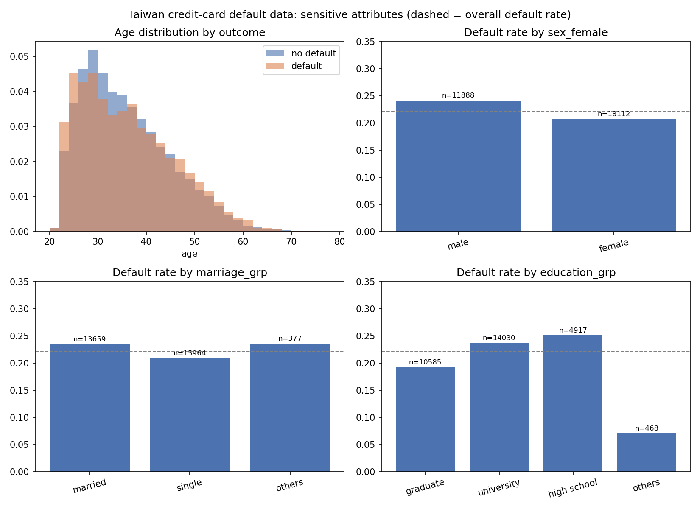
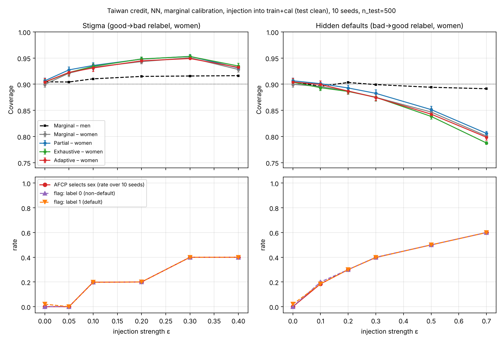
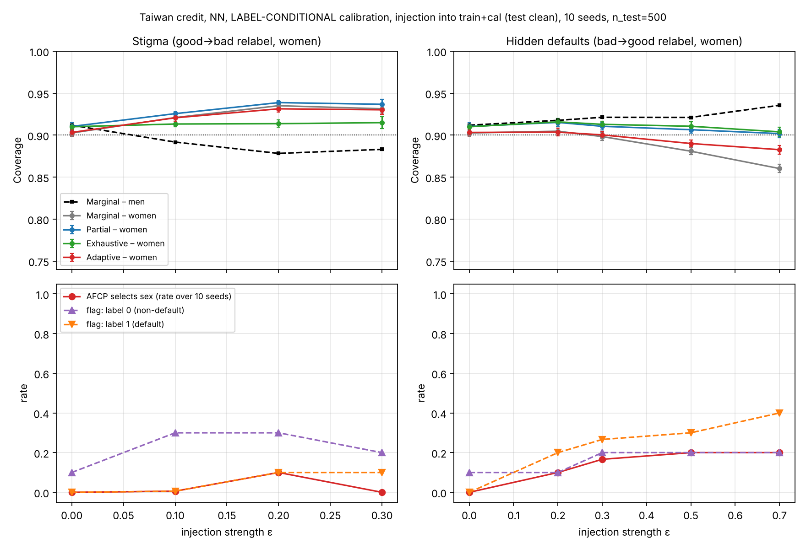
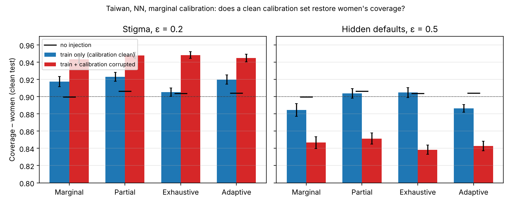

# Default of Credit Card Clients (Taiwan) — Dataset Documentation

Source: Yeh, I-C., & Lien, C-H. (2009). *The comparisons of data mining techniques for
the predictive accuracy of probability of default of credit card clients.* Expert Systems
with Applications 36(2), 2473–2480. UCI Machine Learning Repository id 350,
https://doi.org/10.24432/C55S3H, licence CC BY 4.0. File in this repository:
`data/default_credit_card_clients.csv` (converted from the UCI `.xls`; SHA-256 in
`data/default_credit_card_clients.sha256`). Added in v2 (14 Oct 2026); see
`docs/V2_DESIGN.md`, Section 1, for why.

## 1. Exploratory data analysis

### 1.1 Overview

- 30,000 credit-card clients (Taiwan, April–September 2005), 23 features, no missing values.
- Target `default payment next month` (1 = default): **22.12 %** default rate — the most
  balanced of the three thesis datasets (SGC 30 %, GMSC 6.7 %).
- Features: credit limit (`LIMIT_BAL`), four demographic fields (`SEX`, `EDUCATION`,
  `MARRIAGE`, `AGE`), six monthly repayment-status codes (`PAY_0`, `PAY_2`…`PAY_6`), six
  monthly bill amounts (`BILL_AMT1–6`) and six monthly payment amounts (`PAY_AMT1–6`).

### 1.2 Undocumented codes and recoding

| field | documented codes (UCI) | undocumented codes found | treatment |
|---|---|---|---|
| `EDUCATION` | 1 graduate, 2 university, 3 high school, 4 others | 0 (14), 5 (280), 6 (51) | folded into 4 "others" (common recode; Le Quy et al. 2022 report the same 468-row "others" group) |
| `MARRIAGE` | 1 married, 2 single, 3 others | 0 (54) | folded into 3 "others" (377 rows) |
| `PAY_0…PAY_6` | −1 pay duly, 1–9 months of delay | −2 (2,759 in `PAY_0`), 0 (14,737) | kept as numeric; −2 = no consumption, 0 = revolving credit (Yeh & Lien replication notes) |

All 30,000 rows are kept (some fairness papers drop rows without stating which:
Kozodoi et al. 2022 use 23,531, Hurlin et al. 2022 use 25,983).

### 1.3 Sensitive attribute candidates

| attribute | groups (n) | default rate | note |
|---|---|---|---|
| **sex** (primary) | male 11,888 / female 18,112 | 0.242 / 0.208 | convention in the fairness literature (Le Quy et al. 2022) |
| marriage | married 13,659 / single 15,964 / others 377 | 0.235 / 0.209 / 0.236 | "others" too small for group-conditional calibration |
| education | graduate 10,585 / university 14,030 / high school 4,917 / others 468 | 0.192 / 0.237 / 0.252 / 0.071 | monotone in education level; "others" small and atypical |
| age < 25 | 2,685 (9 %) | 0.272 vs 0.216 | Kozodoi et al. (2022) convention |
| age 3-way (≤35 / 36–55 / >55) | 16,809 / 12,347 / 844 | 0.214 / 0.228 / 0.265 | same cut as GMSC for cross-dataset comparison; >55 small (2.8 %) |

Default rate by age decade: 20–29 0.228, 30–39 0.203, 40–49 0.230, 50–59 0.249, 60+ 0.283
(U-shaped, unlike GMSC's monotone decline). Intersection sex × age: women aged >55 have the
highest default rate (0.296, n = 405), men aged 36–55 the second highest (0.255).

### 1.4 Decisions

- Primary sensitive attribute: **sex**. Candidate set for AFCP's multi-attribute selection:
  sex, marriage, education, age < 25 (and age 3-way in a secondary configuration).
- For the AFCP candidate set the two small "others" levels are merged into the nearest
  level (marriage others → single; education others → high school) so that no candidate
  group has fewer than ≈50 (group × default) calibration points; the unmerged levels are
  reported in the EDA only.
- Class imbalance is left as is (no resampling), as in the fairness benchmarks.
- Cell counts for the planned split sizes (n_train = n_calib = 6,000, n_test = 10,000):
  `thesis_experiments/results/v2/cell_counts_taiwan_credit.csv`. Smallest primary cell
  (male × default) ≈ 575 calibration / 958 test points → coverage SE ≈ 1 pp.

### 1.5 Figure

Produced by `thesis_experiments/v2/eda_taiwan.py`; tables in
`thesis_experiments/results/v2/eda_taiwan_tables.md`.

## 2. Experiments (v2)

All runs: n_train = n_calib = 6,000, n_test = 500, α = 0.1, 10 seeds (2023–2032),
original AFCP code (t-test δ = 0, sig_level = 0.1), neural network with early stopping
(dropout, patience 20) or logistic regression. Raw per-run files:
`thesis_experiments/results/v2/afcp/taiwan/`.

### 2.1 Baseline (clean data)

Overall coverage / mean set size, averaged over 10 seeds (`cal_auroc` ≈ 0.76 NN, 0.72 LR):

| model | calibration | Marginal | Partial | Exhaustive | Adaptive (AFCP) | AFCP: selects sex / education / age<25 / none |
|---|---|---|---|---|---|---|
| NN | marginal (`conditional=False`) | 0.902 / 1.34 | 0.908 / 1.37 | 0.906 / 1.35 | 0.906 / 1.36 | 0.00 / 0.28 / 0.30 / 0.42 |
| NN | label-conditional (`conditional=True`) | 0.906 / 1.69 | 0.912 / 1.72 | 0.908 / 1.71 | 0.905 / 1.69 | 0.00 / 0.10 / 0.00 / 0.90 |
| LR | marginal | 0.904 / 1.40 | 0.908 / 1.42 | 0.906 / 1.41 | 0.903 / 1.41 | 0.10 / 0.10 / 0.30 / 0.50 |
| LR | label-conditional | 0.902 / 1.72 | 0.907 / 1.75 | 0.901 / 1.74 | 0.901 / 1.72 | 0.00 / 0.20 / 0.00 / 0.80 |

Coverage by sex (NN, marginal): men 0.904 / women 0.900 (Marginal), set sizes 1.38 / 1.31.
No sex disparity on clean data; AFCP never selects sex at baseline. The label-conditional
regime costs ≈ 0.35 in set size and makes AFCP select nothing in 80–90 % of seeds.

### 2.2 Bias injection into women (train + calibration, test clean; NN, marginal regime)

Two directions, ε = share of women's labels flipped. Summary CSV:
`thesis_experiments/results/v2/taiwan_injection_summary.csv`; figure below.

**Stigma (good → bad relabel):**

| ε | cov women (Marginal) | cov men | set size women / men | AFCP selects sex |
|---|---|---|---|---|
| 0 | 0.900 | 0.904 | 1.31 / 1.38 | 0.00 |
| 0.05 | 0.921 | 0.904 | – | 0.00 |
| 0.10 | 0.932 | 0.910 | – | 0.20 |
| 0.20 | 0.943 | 0.915 | – | 0.20 |
| 0.30 | 0.951 | 0.916 | 1.74 / – | 0.40 |
| 0.40 | 0.928 | 0.916 | – | 0.40 |

**Hidden defaults (bad → good relabel):**

| ε | cov women (Marginal) | cov men | gap | cov women Partial / Exhaustive | AFCP selects sex |
|---|---|---|---|---|---|
| 0 | 0.900 | 0.904 | 0.02 | 0.906 / 0.905 | 0.00 |
| 0.10 | 0.896 | 0.896 | – | – | 0.18 |
| 0.20 | 0.887 | 0.903 | – | – | 0.30 |
| 0.30 | 0.875 | 0.899 | – | – | 0.40 |
| 0.50 | 0.847 | 0.894 | 0.09 | – | 0.50 |
| 0.70 | 0.801 | 0.891 | 0.12 | 0.806 / 0.788 | 0.60 |

Reading of the two directions (to be developed in the thesis):

- Stigma makes the model over-predict default for women; marginal CP then *over-covers*
  women (0.90 → 0.95) with larger sets (1.31 → 1.74). The disparity is in **informativeness**,
  not coverage.
- Hidden defaults make the model under-predict default for women; marginal CP *under-covers*
  women (0.90 → 0.80 at ε = 0.7) while men stay at ≈ 0.90. This is a **coverage disparity**
  of up to 12 pp.
- AFCP's selection of sex rises monotonically with ε in both directions (0 → 0.4 stigma,
  0 → 0.6 hidden defaults). Selection is essentially a per-seed decision: within a seed the
  LOO t-test flags (almost) all or none of the test points, and the label-0 and label-1 flags
  coincide, so the label-intersection veto is not what limits detection here.
- Because the calibration set carries the same corrupted labels as the training set, the
  group-conditional methods (Partial, Exhaustive, Adaptive) **do not restore** women's coverage
  on the clean test set (0.79–0.81 at ε = 0.7): equalized coverage is guaranteed w.r.t. the
  calibration labels, not the true labels. This is the central methodological point.

### 2.3 Same injection under the label-conditional regime (NN, `conditional=True`)

Grid: stigma ε ∈ {0.1, 0.2, 0.3}, hidden defaults ε ∈ {0.2, 0.3, 0.5, 0.7}, train + calibration,
10 seeds. Full table in `thesis_experiments/results/v2/taiwan_injection_summary_all.csv`.

| direction | ε | cov women / men (Marginal) | cov women Partial / Exhaustive | AFCP selects sex | flag label 0 / label 1 |
|---|---|---|---|---|---|
| none | 0 | 0.903 / 0.912 | 0.910 / 0.911 | 0.00 | 0.10 / 0.00 |
| stigma | 0.2 | 0.935 / 0.878 | 0.939 / 0.913 | 0.10 | 0.30 / 0.10 |
| stigma | 0.3 | 0.931 / 0.883 | 0.937 / 0.915 | 0.00 | 0.20 / 0.10 |
| hidden defaults | 0.3 | 0.898 / 0.921 | 0.911 / 0.912 | 0.17 | 0.20 / 0.27 |
| hidden defaults | 0.5 | 0.881 / 0.921 | 0.906 / 0.911 | 0.20 | 0.20 / 0.30 |
| hidden defaults | 0.7 | 0.860 / 0.936 | 0.902 / 0.904 | 0.20 | 0.20 / 0.40 |

- Under the label-conditional regime the coverage disparity is smaller than under the
  marginal regime (women 0.86 vs 0.80 at ε = 0.7) and Partial / Exhaustive **do** bring
  women back to ≈ 0.90 even though the calibration labels are corrupted: the defaulters that
  remain labelled are genuine, so the per-label quantile for the default class stays valid.
- Stigma now also pushes **men** below nominal (0.88): the pooled per-label quantiles are
  dominated by the inflated female default class.
- AFCP selection is weak here (≤ 0.2) and the label-0 and label-1 flags differ (0.20 vs 0.40
  at ε = 0.7): in this regime the label-intersection veto *is* the limiting factor — the
  pattern seen in the Phase-1 pilot.
- Set sizes are ≈ 1.7 throughout (vs ≈ 1.35 in the marginal regime).

### 2.4 Train-only injection: does a clean calibration set restore coverage? (NN, marginal regime)

Same injection applied to the training set only; calibration and test clean. ε = 0.2 (stigma)
and 0.5 (hidden defaults), 10 seeds. Women's coverage on the clean test set:

| direction, ε | scope | Marginal | Partial | Exhaustive | Adaptive |
|---|---|---|---|---|---|
| stigma 0.2 | train only | 0.918 | 0.923 | 0.905 | 0.920 |
| stigma 0.2 | train + cal | 0.943 | 0.948 | 0.948 | 0.945 |
| hidden defaults 0.5 | train only | 0.885 | 0.904 | 0.905 | 0.887 |
| hidden defaults 0.5 | train + cal | 0.847 | 0.851 | 0.838 | 0.843 |
| (no injection) | – | 0.900 | 0.906 | 0.904 | 0.904 |

- With a clean calibration set, Exhaustive and Partial equalized coverage restore women to
  ≈ 0.90 in both directions; with a corrupted calibration set none of the methods do. This
  is the direct evidence for the point made in 2.2: group-conditional CP equalizes coverage
  with respect to the labels it is calibrated on.
- Adaptive stays close to Marginal in the train-only setting because AFCP rarely selects
  sex when the calibration labels are clean (0.1–0.4).
- Train-only stigma at ε = 0.5 (not in the table) lowers women's coverage to 0.87 under
  Marginal: a model that over-predicts default for women is miscalibrated for them even when
  the calibration labels are correct; Exhaustive restores 0.90.

### 2.5 Logistic regression (robustness to the classifier; marginal regime, train + cal)

Same injection with the logistic-regression classifier (`cal_auroc` ≈ 0.72 vs 0.76 for the
NN), ε ∈ {0.2, 0.5}, 10 seeds. Women's / men's coverage under the Marginal method and
AFCP's selection rate:

| direction, ε | NN: women / men | NN: AFCP sel. | LR: women / men | LR: AFCP sel. |
|---|---|---|---|---|
| none | 0.900 / 0.904 | 0.00 | 0.899 / 0.912 | 0.10 |
| stigma 0.2 | 0.943 / 0.915 | 0.20 | 0.944 / 0.914 | 0.30 |
| stigma 0.5 | (0.928 / 0.916 at ε = 0.4) | 0.40 | 0.820 / 0.918 | 0.40 |
| hidden defaults 0.2 | 0.887 / 0.903 | 0.30 | 0.879 / 0.911 | 0.20 |
| hidden defaults 0.5 | 0.847 / 0.894 | 0.50 | 0.821 / 0.913 | 0.40 |

- The two classifiers agree to within ≈ 1 pp at ε = 0.2 in both directions and in AFCP's
  selection rate; the findings in 2.2 are not NN-specific.
- Stigma is non-monotone: at ε = 0.5 (LR) women's coverage drops to 0.82 — once most
  women are labelled as defaulters the model under-covers the (truly good) majority. The NN
  grid shows the turn at ε = 0.4 (0.951 → 0.928). Stigma at moderate doses produces
  over-coverage with larger sets; at high doses it becomes under-coverage.

Pending: sensitivity to `ttest_delta` / `sig_level` (optional).

## References

- Yeh, I-C., & Lien, C-H. (2009). Expert Systems with Applications, 36(2), 2473–2480.
- Le Quy, T., Roy, A., Iosifidis, V., Zhang, W., & Ntoutsi, E. (2022). A survey on datasets
  for fairness-aware machine learning. WIREs Data Mining and Knowledge Discovery, 12(3).
- Kozodoi, N., Jacob, J., & Lessmann, S. (2022). Fairness in credit scoring: Assessment,
  implementation and profit implications. European Journal of Operational Research, 297(3).
